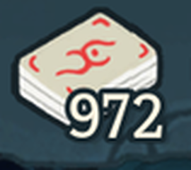
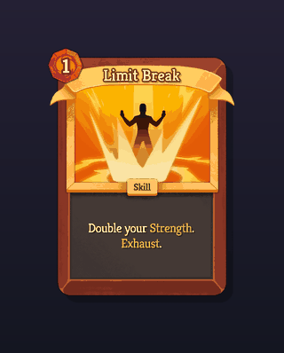
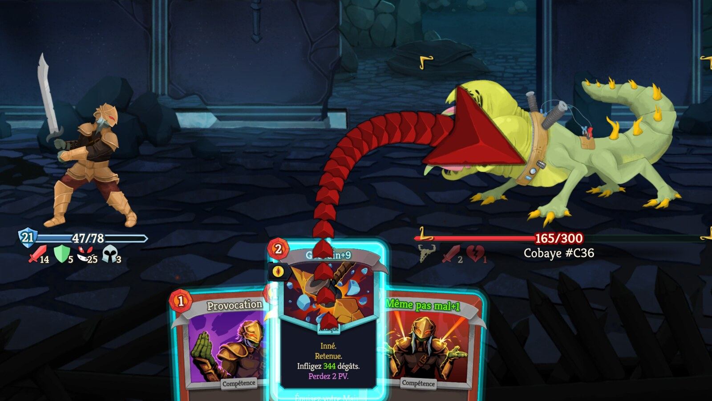
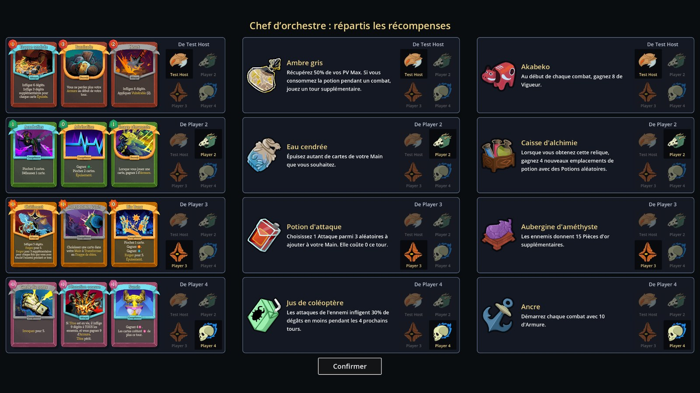

# Slay the Spoon

<p align="center"></p>

A Slay the Spire 2 mod for chaotic co-op and solo runs: it brings Slay the Spire 1 cards into
Slay the Spire 2 and adds run options that the lobby host sets in the **Custom Run** screen.
Daily runs stay vanilla. Standard runs can offer the Spire Souvenir relic described below, the Folie à deux and
Slay the Spoon cards start Standard runs in those modes, and Neow's cursed option is sometimes Deck of 10.

> **Unofficial.** This mod is not affiliated with, endorsed by or sponsored by Mega Crit.
> Slay the Spire, Slay the Spire 2 and their assets (art, card text) belong to Mega Crit.
> The mod is free; there is no paid content.

> **Vibe coded.** The code in this repository was written with AI coding agents (Claude and Codex) under
> the direction of the author, who designed the mod and tests it in game.

> **Found a bug?** Every mode has been through a long series of automated co-op runs; balance will be tuned by hand. Tell me
> what you were doing (modes and options ticked, solo or co-op, character, last action) and attach your
> `godot.log` (`%APPDATA%\SlayTheSpire2\logs\` on Windows, `~/.local/share/SlayTheSpire2/logs/` on Linux). The code is public.
> You are entirely free to fork the mod and make your own version.
>
> **Got an idea for a wacky Custom Run mode?** Leave it in a Workshop comment or a GitHub issue.

## Features

Current version: **1.9.0**.

- **Monster HP** and **Monster Damage** options in Custom Run, 25% to 500% in 25% steps (− / + buttons,
  or left/right on a gamepad), synced to every player in co-op and kept in saves. The top bar shows each one as its percent,
  red when monsters are stronger than vanilla and blue when weaker.

- **Modded profile:** with mods active, Slay the Spire 2 uses a separate "modded" profile. On the
  first modded launch the game itself copies your regular saves into it (one time); the mod adds no
  copy of its own since 1.3.8.

- **Card sets:** two Custom Run options, at most one ticked. **Slay the Spire 1 Cards** offers
  Slay the Spire 1 cards instead of Slay the Spire 2 ones in rewards, shops and card generation;
  **Spire Souvenir** starts every character with the Spire Souvenir
  relic (below), which mixes the two. With neither and without the relic, cards are vanilla. A card that exists in
  both games is offered once: as its weaker version when only the numbers differ, and as either
  version when it plays differently, with a button to switch between the two on card rewards, at
  the merchant and on choose-a-card screens. After a reward grid (Sealed Deck), each such card kept
  asks which version to take.

- **Ironclad's Slay the Spire 1 cards:** the 31 cards that Slay the Spire 2 dropped (Heavy Blade,
  Searing Blow, Limit Break, Berserk…), plus Slay the Spire 1's Juggernaut, Rampage, Rupture, Clash,
  Dual Wield, Entrench and Shockwave,
  with their Slay the Spire 1 art and numbers. The Ironclad's starting deck is the same
  in both games.

- **Silent's Slay the Spire 1 cards:** the 37 Silent cards that Slay the Spire 2 dropped or changed
  (Catalyst, Corpse Explosion, Wraith Form, A Thousand Cuts, Grand Finale…), with their Slay the
  Spire 1 art and numbers.

- **Defect's Slay the Spire 1 cards:** 38 cards ported with their Slay the Spire 1 art and numbers
  (Electrodynamics, Recursion, Seek, Amplify, Self Repair…), including four switchable versions:
  Chill, Fusion, Storm and Tempest. The starting deck stays the same; Orbs use Slay the Spire 2's
  mechanics. Regent and Necrobinder keep their vanilla character pools.

- **Colorless Slay the Spire 1 cards:** 31 cards ported with their Slay the Spire 1 art and numbers
  (Apotheosis, Chrysalis, Madness, Magnetism, Panache, Secret Weapon…), for every character.
  The colorless pool follows the card set mode for all five characters, and the Spire Souvenir mixes
  both games' colorless cards for its owner. Apotheosis, Apparition, Bite, Enlightenment, J.A.X.,
  Metamorphosis and Ritual Dagger stay out of ordinary rewards, shops, transforms and random card
  generation: events that give their Slay the Spire 2 counterpart give the matching version, and
  Bite, J.A.X. and Ritual Dagger come from the Slay the Spire 1 events below.

- **Slay the Spire 1 events:** Vampires(?), Augmenter and The Nest, with their Slay the Spire 1 art and
  text, can replace an act 2 event when Slay the Spire 1 cards are in play: in a "Slay the Spire 1
  Cards" run, or when a player holds the Spire Souvenir. The Nest and Augmenter need one holder; in
  co-op, players without the relic see their card option locked. Vampires needs every player to hold
  it. Augmenter can also give **Mutagenic Strength**, a relic ported from Slay the Spire 1. Golden Idol, Forgotten Altar, Moai Head, Cursed Tome,
  Ominous Forge, Bonfire Spirits and Mind Bloom joined them later, with their relics and curses.

- **The Watcher:** Slay the Spire 1's Watcher is always visible and selectable as a sixth character in a Custom Run,
  on both host and client. She is also selectable in Standard, solo and co-op. In either solo mode, choosing her implicitly enables the StS1 card set (including colorless
  cards and StS1 event eligibility), even without ticking **Slay the Spire 1 Cards**. This also applies after resuming.
  In co-op, the lobby modifiers still determine the shared card set; her own cards remain StS1.
  Unticking modifiers never hides or deselects her. She is not offered in Daily. Random can pick her in Standard and Custom Runs.
  She brings stances (Wrath, Calm, Divinity), Mantra and Scry, 71 cards plus her 4 starter cards and the cards they create, her
  relics and her three potions, with Slay the Spire 1 art and numbers. Her visuals are static images for now (no
  animation). Discipline and Unraveling, which Slay the Spire 1 never registered, are not ported. Holy Water and Violet
  Lotus work but cannot be found yet. In a solo run her ascension is capped by your best vanilla character. Her
  playtime goes into the modded profile and never counts toward the regular unlocks. Needs in-game validation; see
  `docs/testing/step-7-checklist.md`.

- **Neow's Blessings:** a Custom Run option that brings back Neow's usual starting choice. Without it,
  any Custom Run option (even this mod's) makes Neow offer nothing, or only the options of modifiers
  like Draft. With it, those options come first, then the blessings.

- **Starting Chest:** at Neow, open a chest and choose 1 of 10 common, uncommon or rare relics for your character; you
  keep your starting relic.

- **StS1 Boss Relics:** the act 2 and act 3 Ancients offer a chest of 3 boss relics instead: their own, Slay the Spire 1's
  shared ones (Busted Crown, Runic Dome, Sacred Bark…) and the character ones. In co-op the chest is shared and
  rock-paper-scissors settles competing picks. Champion Belt, Magic Flower and The Specimen are Rare relics in runs with
  Slay the Spire 1 cards.

- **Campfire Sales** (co-op): spend your rest site action to sell a deck card to an ally for 0–999 gold; any shortfall
  becomes a loan, like Merchant Loans. The buyer must accept. No curses.

- **Spire Souvenir:** a Common relic of every character, also found in Standard runs, that lets its owner find
  cards from the other game (only colorless cards for the Necrobinder and the Regent): Slay the Spire 1 cards in a normal run, Slay the Spire 2 cards in a
  "Slay the Spire 1 Cards" run. It only affects its owner; losing it ends the effect. It never drops
  in a "Spire Souvenir" run (every player already starts with it) or in a Daily run.

- **`sts1card` console command** for testing: in a modded game the developer console opens with the
  `` ` `` key (`*` or `'` on AZERTY); `sts1card STS1_HEAVY_BLADE` puts that card in your hand in combat,
  or in your deck elsewhere. The vanilla `card` command can't see Slay the Spire 1 cards.
  `sts1event STS1_NEST` (or `STS1_VAMPIRES`, `STS1_AUGMENTER`) opens a Slay the Spire 1 event.

**Folie à deux** (co-op): an extra card on the multiplayer host screen starts a Standard run with it; Custom Runs have it
as a checkbox. Every card reward goes into a chest: each player bids on one head, rock-paper-scissors settles ties, and
an unclaimed head is lost. Draft and Sealed Deck hand every player one head. Solo runs are unaffected.

**Matriochka** (Custom Run): Hoarder, a card reward you cannot skip on every floor, and a few dolls along the way.
The row's − / + sets the card reward rerolls each player gets per act (3 by default).

<p align="center"></p>

Both modes still need in-game validation; see `docs/testing/two-modes-checklist.md`.

**King Midas** (Custom Run): every player starts with the gold relics (Bowler Hat, Maw Bank, Old Coin, Membership Card,
The Courier and more). No card rewards anywhere: cards come from the merchant. Every "?" event is a gold event, and gold
is its only way out. Rest site actions cost gold (50, then 50 more each time at the same fire) and can be repeated. Gold melts on every floor (10 %, at least the average gold earned per floor): a player left with no gold dies; in co-op they come back for the next room with 1 gold and 1 HP (unless everyone was ruined at once).
Each purchase raises the merchant's other prices by 10 %, and nothing is sold that would leave you ruined.
The merchant buys your relics for 75 % of their price (not the starting relics, nor Ancient or Event relics) and puts each
one back on sale in your shop, dearer; a broken Maw Bank can be reopened there for 50 gold (plus the price rise). Not with Matriochka. Not tested in game: `docs/testing/roi-midas-checklist.md`.

**The Forge** (Custom Run): two copies of a card fuse at a rest site's new Fuse option, past +1 and up to +9. Levels
add up, plus one: Strike+1 fused with Strike+1 gives Strike+3. Each level repeats the card's +1 numbers; its cost and
keywords stay as at +1. Numbers that would break the game stop growing earlier (energy and extra plays at +3, draw at +5;
the table is `docs/review/forge-curves.md`), while the card's other numbers keep going. Every card gains Retain at +6,
costs 1 less at +7 and becomes Innate at +9. Limit Break gains 1 Strength per level past +1 before doubling. A StS1 card fuses
with its StS2 namesake and you pick which one comes out. Ordinary upgrades still stop at +1. Once per visit, the merchant
sells a +0 copy of a deck card: 25 / 50 / 75 gold by rarity (+25 from Ascension 6), +25 per earlier purchase.
Forged cards show their level: from +2 the title climbs a color ladder and the frame turns Ancient step by step; at +9
the card is fully Ancient and its title shimmers like a diamond (1.8.1). With "View Upgrade" ticked on a card, a panel
beside it lists every level up to +9; hover one to see it (1.11.0).

*Tip (from the author):* upgrade your copies first, then fuse the upgraded ones. Each copy's +1 counts: +1 and +1 give
+3, two +3 give +7, and +7 with one more +1 reaches +9, which takes five copies and four fusions.

Not tested in game: `docs/testing/forge-checklist.md`.

<p align="center"></p>

<p align="center"></p>

**Cursed Deck** (Custom Run): every player starts with the Unholy Grimoire and a random curse. With the Grimoire, curses
cost 1 (0 upgraded), target an enemy and turn their own effect against it: Bad Luck makes the monster lose 13 HP, Doubt
weakens it. Curses can be upgraded in this mode. Every "?" event gets an "Embrace the curse" option (a curse for a cursed
relic, gold or a heal), and relic draws from chests, elites and the merchant are cursed 2 times in 3 until you hold them
all, including four new ones: Blood Pact, Pin Doll, Black Censer and Reliquary. Not tested in game:
`docs/testing/cursed-deck-checklist.md`.

**Forged curses** (The Forge and Cursed Deck together): curses fuse at the fire and the merchant duplicates them, up to
+9. Each level repeats the +0 → +1 step on both sides (Bad Luck+9: 76 HP to the enemy when played, 76 to you if it stays
in hand), and the curse picks up a defect at +3, +6 and +9: unplayable on odd or even turns or before turn 3, playable
only after two other cards, costs 2 more, costs HP, hits its owner twice in hand, spreads a curse, eats a card from your
hand, or echoes half its effect back at you. Eternal curses never fuse. Levels per curse: `docs/review/cursed-curses.md`.
Not tested in game: `docs/testing/forged-curses-checklist.md`.

**Overcursed** (Custom Run): every curse you receive comes in three (with Hoarder or Matriochka, still three), and every "?"
event offers Cursed Deck's "Embrace the curse" (gold every time under King Midas). The merchant still removes curses.
Ascender's Bane is replaced by the mod's own curse, the **Witching Hour** (Eternal, Innate): on odd turns it is unplayable,
your other cards cost 1 more while it is in your hand, and it is drawn 80 % of the time; played through the Unholy
Grimoire on an even turn, the chosen enemy skips its next turn. The Cursed Deck's cursed relics turn up at merchants
and from the random relics of "?" events (5 pulls in 6 there instead of 2 in 3), and Embrace gives a cursed relic 2 times
in 3 while one is left; chests and elites follow Cursed Deck.

**Achilles' Heel** (Custom Run): every player starts with the Achilles' Heel relic plus Anchor, Oddly Smooth Stone and
Gorget. In every combat, unblocked attack damage kills you (Poison and HP loss don't). You gain 1 Dexterity per act past
the first, your attacks deal 1 more damage per 5 Block you have, and card offers lean toward Block cards. HP stays vanilla,
so it combines with the Spoon. Not tested in game: `docs/testing/achilles-heel-checklist.md`.

**Glass Cannon** (Custom Run): every player starts with the Glass Heart relic plus Vajra and Girya. Each combat starts
with 99 Frail and Frenzy: every card played adds 10 % attack damage (Osty's too), and each turn without a Skill that gives
Block adds Strength (1, then 2, then 3...). Such a Skill resets both; Attacks and Powers with Block don't. With Achilles'
Heel as well, card offers lean toward Block cards and Attacks. Not tested in game: `docs/testing/glass-cannon-checklist.md`.

**Challenges** (Custom Run): **Blood** (no gold: prices are paid in HP, with the Blood Fang relic), **Deck of 10** (a
relic keeps your deck at 10 cards; each card dropped gives 1 max HP; Neow's cursed option is sometimes Deck of 10 in
Standard runs too), **Mutation** (each new act transforms every card that is not upgraded), **Trophies** (each elite you
beat gives one of its attacks as a card), **Useless Relics** (click a relic that has done its job to throw it for 10
damage; it comes back after the fight), and in co-op **Forced Trade** (after each victory everyone gives a card to a
random ally) and **Conductor** (one player hands out each reward). Not tested in game:
`docs/testing/backlog-modes-checklist.md`.

<p align="center"></p>

**Slay the Spoon** (a card on the solo and multiplayer host screens, or a Custom Run checkbox): max HP becomes the currency of the run. Everyone starts with a Spoonful, a Retain card that
kills to feed: a fatal blow with it raises your max HP. Everyone also starts with the 12 max HP relics, every rest site offers a
Feast (+5 max HP) and Digest (−15 max HP, heal to full), and every merchant sells Fruit Juice. When the team's max HP adds up to **300 solo, 550 for two, 750
for three or 900 for four**, a Spoon act is inserted after the last act 3 boss: one rest site, then the Spoon. Every
player fights it.

The Spoon has 1200 HP in solo (vanilla multiplayer scaling in co-op) and a four-move cycle:
- **Sets the Table**: Frail on everyone, Appetite for the Spoon, and a cutlery kit shuffled into every draw pile, one
  of each spoon every cycle plus extras for big decks (25+ cards). Ignore the kit and your deck fills up.
- **Mouthful** (25): the Spoon gains Block equal to the damage that got through.
- **Banquet**: Vulnerable, 8 HP loss through Block, eats 10 max HP, and heals the Spoon (30, +10 per extra player).
- **Ladle Smash** (35): steals max HP from the players it hits.

Damage that gets through Block grows the Spoon's max HP, and its Strength follows its max HP (+1 per 5 above its
combat-start value, −1 per 5 below). Each Appetite stack is +5 % damage, for the Spoon or for a player.
Appetite runs through the whole Spoon run: in every fight, each monster hit on a player, even fully blocked, moves 1
Appetite from that player to the monster, and the Spoonful removes 1 (2 upgraded) from any monster it hits. It resets
every combat.
The cutlery answers each mechanic: **Teaspoon** (remove Appetite, draw), **Wooden Spoon** (hit for 10 % of your max HP,
Appetite does nothing next turn), **Skimmer** (Block; Banquet takes nothing from you), **Melon Baller** (take 12 max HP
from the Spoon). During the fight your Spoonfuls become **Stolen Spoonfuls**, attacks that steal Appetite.

Art is placeholder. The balance was play-tested by the author in solo; co-op still needs checks, see
`docs/testing/spoon-checklist.md`.

**Merchant Loans** (co-op Custom Runs): enable the modifier in the lobby. If a merchant purchase
fails for lack of gold, choose **Ask** to open a request. Other players can lend gold at 0–900%
interest or give it. Offers reserve the lender's gold until accepted, withdrawn, cancelled, or the
room is left. Select enough offers and accept, then try buying the item again.

Future gold gains repay the oldest loan first, shared equally between its remaining lenders.
Interest is fixed on acceptance; gifts create no debt. **Death and resurrection do not erase debts.**
Debts are saved with the run. Hover your gold to see what is left to repay or collect; the loan panel works with a
controller. Solo, Standard and Daily runs are unaffected.
The merchant interface still needs in-game validation; see `docs/testing/step-5-checklist.md`.

**Character Color** (pause menu, every mode): tint your character with a color overlay, or recolor only the parts close
to its own color (the threshold sets how close); optionally color your map drawings too. Saved for you and shown to
your co-op partners. It is cosmetic only.

**Act 4, The Ending:** unlocking Ascension 5 with any character enables Act 4 by default in Standard runs
at every ascension level, including 0. Profiles with the earlier permanent unlock retain access.
Collect the Ruby, Emerald and Sapphire keys (one set for the whole team in co-op). The Sapphire Key sits in chests as
one more choice beside the relics: in solo you take it instead of the relic; in co-op players who pick the same relic or
the key play rock-paper-scissors for it, and the losers rematch for what is left. With all three keys, the Act 3 boss
gives its rewards and the run continues into The Ending: a rest site, a merchant, the Spire Shield and Spear, then
the Corrupt Heart. Without all keys the run ends after Act 3 as usual. A Custom Run option, "Act 4", turns on the
keys and Act 4 without the unlock. Daily runs are unchanged. It still needs in-game validation; see
`docs/testing/step-6-checklist.md`.

## Development status — 2026-11-23

Version **1.11.6**: the Witching Hour no longer shows "Unplayable" twice; 1.11.5: clearer Witching Hour text; 1.11.4: small fixes (Useless Relics throws the mod's combat-start relics); 1.11.3: restaurant ambience in the Spoon act; 1.11.2: Overcursed's cursed relics at merchants and events; 1.11.1: the Witching Hour curse; 1.11.0: the Overcursed mode and the Forge ladder, after forged curses (1.10.0), King Midas's relic sale (1.9.0), a long wave of fixes found
by automated co-op runs (1.8.3–1.8.34), Glass Cannon (1.8.0), Cursed Deck, Achilles' Heel and seven Custom Run challenges
(1.7.0), The Forge (1.4.0) and the port to game version 0.111.1 (1.3.8). The build has no warnings and every unit test
passes. Most features still need in-game checks; the [testing checklists](docs/testing/) record them.

### Recent fixes

- Co-op desyncs: patches the game silently dropped on one player are restored before every action (1.8.6–1.8.31).
- King Midas: doubled starting gold, rest site softlock and crash; ruined players come back in co-op (1.8.5–1.8.33).
- The Watcher: crashes on her death, at the Architect, at rest sites and at Darv (1.8.10–1.8.23).
- Deck of 10 black screen at Neow (1.8.3), Folie à deux chest off screen (1.8.18), co-op boss chest wait (1.8.21).
- Matriochka: works with Vintage and Hoarder, no card after the final boss, 999 cards max (1.8.17–1.8.29).

## Languages

English and French. Other game languages show the English text.

## Install

Every player in a co-op lobby needs the same version of the mod.

Slay the Spoon requires [BaseLib](https://steamcommunity.com/sharedfiles/filedetails/?id=3737335127)
3.4.7 or later (declared in `SlaySpoon.json`; the game refuses to load the mod without it).

- [Steam Workshop](https://steamcommunity.com/sharedfiles/filedetails/?id=3829630403): public, early and barely tested. BaseLib is a required item: subscribing to Slay the Spoon
  offers to subscribe to it too.
- Manually: install BaseLib, then copy the `SlaySpoon` folder (containing `SlaySpoon.json`, `SlaySpoon.dll`,
  `SlaySpoon.pck`) into `<Slay the Spire 2>/mods/`, then start the game and accept mod loading.

## Build

Requires Podman and Slay the Spire 2 installed through Steam (Linux).

```bash
make build     # build/mods/SlaySpoon/
make test      # unit tests
make up        # build and install into the game's mods folder
make down      # uninstall
make mp        # two local game windows (host + client) to test co-op
make sts1-data # regenerate card data, art and text from a Slay the Spire 1 install
make workshop-upload # upload build to the Steam Workshop (SteamCMD in Podman, asks for Steam login)
```

Set `STS2_DIR` if the game is not in the default Steam library. `make sts1-data` also needs
Slay the Spire 1 and its decompiled card classes (`STS1_DECOMP`, `STS1_JAR`; see the `Makefile`).

## License

MIT for the code in this repository (see `LICENSE`). Game assets are Mega Crit's.

## Bugs

Paste the error part of your `godot.log` in a Workshop comment (modes ticked, solo or co-op), or attach the whole log
to a [GitHub issue](https://github.com/Dratharias/slay-the-spoon/issues). Log: `%APPDATA%\SlayTheSpire2\logs`
(Windows), `~/.local/share/SlayTheSpire2/logs` (Linux).
